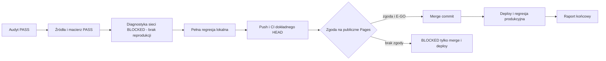

# MAD-NET — final recovery i kontrolowany merge

Data bazowa i wykonania: 2026-11-02, Europe/Warsaw. Wynik sesji: diagnostyka i lokalna regresja wykonane; C/E-GO/F/G pozostają BLOCKED. Obowiązują [STAN.md](finalizacja-2026-11-02/STAN.md) i [WYNIKI.json](finalizacja-2026-11-02/WYNIKI.json). Brak oznaczenia PASS oznacza brak zamkniętej bramki.

## Audyt A i źródła B

Odczytano całą instrukcję `MAD-NET_CODEX_FINAL_RECOVERY_MERGE.md` z głównego worktree oraz AGENTS, README, PLAN_ROZWOJU, DECYZJE, ARCHITEKTURA i raport RECOVERY 04 z worktree integracji. Wykonano fetch, audyt wszystkich worktree, gałęzi, PR #3–#6, workflow, ochrony main i Pages.

- `origin/main` i lokalny `main`: `1987ad3aa8a65fd1aa86f077af1addf3225bb228`.
- Początkowy HEAD integracji, remote i [PR #6](https://github.com/kapi1944/MAD-NET/pull/6): `1828bb8697769ef019de7a932f1dc3dd2b4e791b`.
- Merge-base: `1987ad3aa8a65fd1aa86f077af1addf3225bb228`.
- Merge źródeł: `73d47ffd6bb892ebd6f40b86d67f922fb0d52855`; obaj rodzice i HEAD źródeł zachowane w historii.
- HERO / [#4](https://github.com/kapi1944/MAD-NET/pull/4): `21aa43e859c38c7d3522846abea15af19079ec69`.
- FIBER / [#5](https://github.com/kapi1944/MAD-NET/pull/5): `3b3d7b4bed91b13cf2c7f9d0cb4fd392680cfd73`.

Oba HEAD źródeł są przodkami #6, `git cherry` nie pokazuje patchy poza integracją. Kluczowe pliki HERO i FIBER wskazane w specyfikacji są identyczne ze źródłami. Scalony HOME zachowuje 11 szerokości i kontrolę ujemną; V20 zachowuje 286 tras, testy kanałów i próg co najmniej 5000 ms. Skrypty npm obejmują HOME, FIBER, LED oraz pozostałe zestawy.

Pełna [macierz gałęzi](finalizacja-2026-11-02/MACIERZ_GALEZI.md) i [surowe metadane audytu](finalizacja-2026-11-02/audyt.json) obejmują wszystkie lokalne i zdalne gałęzie oraz odłączony worktree. Starsze gałęzie z ahead=0 są potwierdzonymi przodkami main; nie wymagają ponownego merge. Nie usuwano worktree, gałęzi ani historii. Główny katalog zachował nieśledzony plik instrukcji; jego SHA-256 zapisano w audycie. Pozostałe worktree były czyste i pozostają nietknięte przez tego agenta. Podczas pracy główny worktree otrzymał zewnętrzny commit `7d8b447a3cd7c79aceb5604bb254918b92623dec` (instrukcja merge), także wypchnięty do gałęzi PR #3; SHA-256 instrukcji pozostał identyczny. Uaktualniony snapshot obejmuje 25 lokalnych/zdalnych refs oraz odłączony worktree.

## Bezpieczeństwo i materiały biznesowe

Repozytorium jest PUBLIC. Cztery wskazane materiały 4×3 są obecne w publicznej gałęzi [PR #3](https://github.com/kapi1944/MAD-NET/pull/3). Są nieobecne w drzewie #6. Nie kopiowano ich treści ani binariów do dokumentacji czy artefaktów. Właściciel musi zdecydować o prywatnym przechowywaniu i dalszej ekspozycji; #3 pozostaje OPEN. Nie wykonywano przepisywania historii i nie deklaruje się usunięcia dotychczasowej ekspozycji.

Build ma allowlistę dziewięciu HTML oraz assets; dokumenty z katalogu głównego i docs nie trafiają do dist. Osobna, wcześniej obecna w main ankieta `MAD-NET_ANKIETA_DECYZYJNA_INTEGRACJA_V3.html` nie należy do czterech materiałów PR #3 i również nie jest kopiowana przez build. Pages w trybie legacy publikuje jednak katalog główny repozytorium; allowlista dist sama nie ogranicza publikacji legacy.

Kontrola treści diff sprawdza tokeny GitHub, klucze AWS/prywatne, przypisania sekretów SMTP/API oraz nazwy plików poufnych. Wyniki i rozmiary artefaktów: `test-results/finalizacja/kontrola-statyczna.json`. Wynik skanowania jest dowodem zastosowanej kontroli wzorców, a nie pełnym audytem bezpieczeństwa. Ceny, nazwy, umowy, opłaty i liczby pakietów chroni test porównania z main; nie zmieniano danych handlowych.

## C — diagnostyka sieci

Historyczny [run PR 41408400330](https://github.com/kapi1944/MAD-NET/actions/runs/41408400330), job `125155574433`, HEAD `1828bb8697769ef019de7a932f1dc3dd2b4e791b`: FAILURE w końcowej asercji konsoli `oferta.browser.mjs:125`. Log zawiera wyłącznie `Failed to load resource: net::ERR_CONNECTION_CLOSED`, bez URL i resourceType. Nie można odtworzyć tych brakujących danych z samego tekstu konsoli. PCB i integracja zostały w tym runie pominięte wskutek poprzedniego błędu; [run push 41408393673](https://github.com/kapi1944/MAD-NET/actions/runs/41408393673) był SUCCESS.

Dodano lokalną diagnostykę obu kontekstów: identyfikatory i pełne URL żądań, typy, fazy, czasy, requestfailed, błędy HTTP/JS/konsoli, poprzedni URL, viewport, aktywne żądania przy nawigacji i zamykaniu, route.fetch oraz stdout/stderr/exit/error serwera. Zachowano wszystkie asercje. JSON jest zapisywany także po niepowodzeniu. CI wykonuje trzy próby Linux i zachowuje oddzielny wynik każdej; błąd dowolnej próby nadal kończy krok kodem niezerowym.

Trzy próby Windows/Edge przed zmianą zakończyły się kodem 0. Trzy kolejne na dokładnym checkpointcie `b86891e083a0538776158ea2373df5de57af8ed9` również: [próby](finalizacja-2026-11-02/proby-po.json), [wersja przeglądarki, zdarzenia i serwer](finalizacja-2026-11-02/oferta-windows.json). W tych trzech przebiegach zapisano 2269/2256/2260 zdarzeń; nie było requestfailed, błędów konsoli/HTTP/JS, a serwer zakończono dopiero w sprzątaniu. Nie dowodzi to usunięcia niestabilności. Przyczyna historycznej awarii pozostaje niepotwierdzona. **C=BLOCKED**: log źródłowy nie zapisał URL/resourceType/fazy, a ponowienia nie odtworzyły problemu. Nie da się uczciwie podać brakujących danych ani udowodnionej poprawki tej konkretnej awarii. Codex przy kolejnym FAIL ma pobrać `finalizacja/oferta-linux-N.json` albo `oferta-network.json`, skorelować identyfikator żądania i fazę z serwerem/lifecycle, a potem wdrożyć minimalną naprawę oraz ponowić całą regresję. Do tego czasu nie zamykać C i nie wykonywać merge.

## D — lokalna regresja

Pierwsze wykonanie wszystkich wymaganych poleceń: `test-results/finalizacja/lokalne-diagnoza.json`, logi `lokalne-*.log`. verify, PCB, integracja 54 układów, FIBER, LED, oferta, nawigacja i diff-check: kod 0. test:browser i osobny HOME: kod 1, oba wskazują 7 pikseli różnicy maksymalnie 1 RGB w narożniku CTA `.sekcja-obszar` przy 768 px, przy identycznej geometrii. Obrazy błędu zachowano. Bramka D nie jest zamknięta na podstawie pozostałych PASS.

Osobna kontrola 36 porównań pojedynczej sekcji (V3/V3, V4/V4, V3/V4; 768 i 2560 px; osobne i wspólna strona) dała zero różnic. Kontrola kolejności pełnego zestawu sekcji i izolacji kontekstu jest zapisana w `test-results/finalizacja/home-kontrola*.json`. Sama izolacja kontekstu nie pomogła. Minimalna zmiana przygotowania wykonuje każdą parę V3/V4 od świeżych dokumentów, bez poprzedzających zrzutów innych sekcji. Pełny eksperymentalny HOME przeszedł 11 szerokości i 77 porównań (zero pikseli); istniejąca próba ujemna nadal wykrywa zmianę koloru nagłówka. [Pomiary i kontrole](finalizacja-2026-11-02/home-diagnoza.json). Ponowiono całą wymaganą sekwencję npm na właściwym pliku testu: wszystkie 11 poleceń (w tym npm ci i diff-check) zakończone kodem 0. [Pełna tabela: czas, exit code, środowisko i log](finalizacja-2026-11-02/lokalne-wyniki.json). Próby ujemne rzeczywistego odcięcia CSS, JS i HTML (`route.abort(connectionclosed)` przez lokalny preload, bez zmian aplikacji i asercji) dały oczekiwany kod 1: CSS wykryty przez geometrię CTA; JS przez działanie menu; HTML przez goto. [URL, typ, fazy i logi prób ujemnych](finalizacja-2026-11-02/ujemne.json). Nie zmieniono tolerancji, masek ani stylów produktu.

Wszystkie 28 śledzonych JS/MJS przeszło `node --check`. Sprawdzono niezerowe rozmiary oraz SHA-256 wymaganych plików dist. Zrzuty HOME/cennika, FIBER, LED i tabel pochodzą z rzeczywistej przeglądarki; pełne zestawy w test-results i artefaktach CI. [Zebrane metryki](finalizacja-2026-11-02/regresja-metryki.json): 286 tras, 112 wyborów z maksymalnym skokiem geometrii 0 px, 54 układy, 38 zgodnych zasobów, HOME 11 szerokości, FIBER 9, LED 6 układów, PCB 9.

| Polecenie | Exit | Start (Europe/Warsaw) | Czas [s] | Dowód |
|---|---:|---|---:|---|
| npm ci | 0 | 2026-11-02T19:30:18.4198448+01:00 | 2.6 | [log](finalizacja-2026-11-02/logi/lokalne-2-npm-ci.txt) |
| npm run verify | 0 | 2026-11-02T19:30:21.0636687+01:00 | 2.8 | [log](finalizacja-2026-11-02/logi/lokalne-2-verify.txt) |
| npm run test:browser | 0 | 2026-11-02T19:30:23.9445003+01:00 | 685.2 | [log](finalizacja-2026-11-02/logi/lokalne-2-test-browser.txt) |
| npm run test:pcb | 0 | 2026-11-02T19:41:49.2091407+01:00 | 16.9 | [log](finalizacja-2026-11-02/logi/lokalne-2-test-pcb.txt) |
| npm run test:integracja | 0 | 2026-11-02T19:42:06.1947758+01:00 | 50.9 | [log](finalizacja-2026-11-02/logi/lokalne-2-test-integracja.txt) |
| npm run test:home | 0 | 2026-11-02T19:42:57.1304787+01:00 | 231.6 | [log](finalizacja-2026-11-02/logi/lokalne-2-test-home.txt) |
| npm run test:fiber | 0 | 2026-11-02T19:46:48.8118376+01:00 | 57.1 | [log](finalizacja-2026-11-02/logi/lokalne-2-test-fiber.txt) |
| npm run test:led | 0 | 2026-11-02T19:47:45.9593455+01:00 | 26.7 | [log](finalizacja-2026-11-02/logi/lokalne-2-test-led.txt) |
| npm run test:oferta | 0 | 2026-11-02T19:48:12.7439291+01:00 | 40.2 | [log](finalizacja-2026-11-02/logi/lokalne-2-test-oferta.txt) |
| npm run test:nawigacja | 0 | 2026-11-02T19:48:52.9805014+01:00 | 41.6 | [log](finalizacja-2026-11-02/logi/lokalne-2-test-nawigacja.txt) |
| git diff --check | 0 | 2026-11-02T19:49:34.6486379+01:00 | 0.8 | [log](finalizacja-2026-11-02/logi/lokalne-2-git-diff---check.txt) |

Środowisko: Windows, Node 24.16.0, Edge. Logi lokalne rejestrują bazowy HEAD `1828bb8697769ef019de7a932f1dc3dd2b4e791b` z patchem później zapisanym bez zmian jako `b86891e083a0538776158ea2373df5de57af8ed9`; Testy i aplikacja pozostają identyczne z checkpointem b86891e. Końcowy commit dokumentacji doprecyzowuje tylko echo SHA w workflow: używa git rev-parse HEAD zamiast github.sha, ponieważ samo pole zdarzenia PR może oznaczać syntetyczny merge SHA. JSON diagnostyki od początku zapisuje rzeczywisty checkout SHA oddzielnie od SHA zdarzenia. Bieżący checkout CI i dodatkowe trzy próby ofert potwierdzają dokładny SHA.

## E — CI i bramka GO

Lokalna bramka wykonania testów jest zamknięta. Pierwszy push służy diagnostyce Linux; nie stanowi zgody na merge. Checkpoint diagnostyki i poprawki HOME: `b86891e083a0538776158ea2373df5de57af8ed9`. Runy: [push 41509200335](https://github.com/kapi1944/MAD-NET/actions/runs/41509200335), [PR 41509211089](https://github.com/kapi1944/MAD-NET/actions/runs/41509211089); oba **completed/success** dla dokładnie wskazanego SHA. Wszystkie kroki, w tym test:browser, PCB, integracja oraz upload, zakończyły się SUCCESS; żadnego nie pominięto. [Metadane, czasy kroków i identyfikatory artefaktów](finalizacja-2026-11-02/ci-checkpoint.json). Artefakty pobrano i przeanalizowano: [PR](finalizacja-2026-11-02/oferta-linux-pr.json), [push](finalizacja-2026-11-02/oferta-linux-push.json), [metryki Linux](finalizacja-2026-11-02/linux-metryki.json). Sześć prób diagnostycznych i dwie oferty w pełnej regresji: brak requestfailed, console-error, HTTP-error i pageerror; serwery kończono dopiero w sprzątaniu. Faktyczny checkout JSON=b86891e, SHA zdarzenia PR=6245c8ec98e6d04bb4814389c85d6775a8ef36c4 (rozróżniono te wartości). C pozostaje BLOCKED mimo tych PASS. Checkout workflow wskazuje jawnie SHA głowy PR (dla push: github.sha), więc GitHub nie zastępuje go syntetycznym merge SHA. Historyczne zielone runy nie stanowią dowodu dla nowego HEAD. **E-GO=BLOCKED przez C.** Samą techniczną bramkę CI checkpointu zaliczono, ale nie stanowi ona usunięcia historycznej niestabilności. Ostatni commit dokumentacyjny zawiera dowody i korektę samego tekstu SHA w workflow; jego bieżące kontrole trzeba także odczytać dla dokładnej głowy z [PR #6 / checks](https://github.com/kapi1944/MAD-NET/pull/6/checks). Przed GO wymagane: lokalny HEAD = origin/head PR #6; oba aktualne runy push/PR completed/success; wszystkie obowiązkowe kroki wykonane; czyste drzewo; aktualny fetch; brak konfliktu i materiałów biznesowych.

GitHub zwrócił `rulesets=[]` oraz HTTP 404 `Branch not protected` dla main. Nie ma skonfigurowanych required checks, ale w tym zleceniu nadal obowiązują wszystkie bramki jakości. Nie używano obejścia administratora.

## F — BLOCKED: decyzja o publicznej publikacji

Pages: `build_type=legacy`, `source.branch=main`, `source.path=/`, `public=true`, brak CNAME. Merge do main jest publiczną publikacją. AGENTS mówi „jeszcze NIE wersja do publikacji”; punkt 7 specyfikacji i bieżące polecenie użytkownika wymagają osobnej jawnej zgody właściciela na ten konkretny efekt. Takiej zgody jeszcze nie otrzymano. Audyt, diagnostyka i lokalne naprawy są kontynuowane.

Właściciel: zatwierdzić publiczne wdrożenie konkretnego zweryfikowanego HEAD #6. Codex: dopiero po E-GO oraz tej decyzji ready + merge commit, fetch, dowód mergedAt/mergeCommit i bezpieczny fast-forward main. Nie wykonano merge, zmiany lokalnego main ani zamknięcia #4/#5. Po merge sprawdzić ich obecność w main i dopiero wtedy zamknąć jako zastąpione przez #6; #3 pozostawić do decyzji.

## G — BLOCKED: nowy deploy i regresja produkcji

Ostatni odczytany build Pages: `built`, commit `1987ad3aa8a65fd1aa86f077af1addf3225bb228`, utworzony `2026-11-01T15:16:56Z`, ukończony `2026-11-01T15:18:07Z`, error.message=null. [Odczyt rzeczywistych 9 HTML i 8 krytycznych CSS/JS](finalizacja-2026-11-02/pages-przed.json): wszystkie HTTP 200, SHA-256 zgodne z origin/main po jawnej normalizacji CRLF→LF. To zweryfikowany punkt odniesienia wcześniejszej wersji. Nie jest to wdrożenie integracji. Nie deklaruje się produkcyjnego PASS #6.

Codex po F: obserwować rzeczywisty pages-build-deployment dla merge SHA, odczytać dziewięć stron pod [Pages](https://kapi1944.github.io/MAD-NET/), porównać SHA-256 faktycznych HTML/CSS/JS z dist (normalizację końców linii udokumentować), wykonać sześć szerokości 320/390/768/1024/1440/1920, regresję integracji/FIBER/LED, menu/CTA/mapy/formularza oraz reduced-motion. Zachować JSON i screenshoty. Nie wysyłać prawdziwego e-maila.

Przy krytycznej regresji: zatrzymać dalsze czynności, zweryfikować rodziców merge SHA i przygotować osobny PR naprawczy z kontrolowanym `git revert -m 1`; pełne CI oraz bramka publikacji przed wdrożeniem. Bez resetu, force push i usuwania historii.

## H — kompletność i ograniczenia

| HERO | FIBER | LINK/ACT | Cennik | Podstrony | Formularz | Testy | CI | Merge | Pages |
|---|---|---|---|---|---|---|---|---|---|
| V4 zachowany | SC/APC Simplex zachowany | zachowany | 13 pakietów, ceny bez zmian | 9 stron zachowane | frontend zachowany | lokalnie PASS, C BLOCKED | checkpoint PASS; GO BLOCKED | BLOCKED F | BLOCKED G |

Dotyk oznacza emulację, bez testu fizycznego telefonu. Backend SMTP pozostaje niewdrożony. Nie potwierdzono biznesowej gotowości treści ani oficjalnego wydania. Niezrobione działania pozostają przypisane w STAN/WYNIKI i powyższych blokadach.

Reprezentatywne aktualne zrzuty: [HOME 390](finalizacja-2026-11-02/zrzuty/home-390.png), [cennik/RACK 390](finalizacja-2026-11-02/zrzuty/cennik-390.png), [podłączone SC/APC i tabela 390](finalizacja-2026-11-02/zrzuty/tabela-fiber-390.png). Przejrzano te obrazy. Pełne sześć szerokości HOME/cennika i pozostałe widoki zachowano w test-results; nie są testem fizycznego telefonu.

## Dokładny punkt wznowienia

1. Codex: **C**, bez ponownego wdrażania HERO/FIBER. Diagnoza źródłowego ERR_CONNECTION_CLOSED pozostaje niepotwierdzona; nowa telemetria jest już w CI, nie wymaga dalszego dokładania nasłuchiwaczy. Przy następnej awarii zebrać prawdziwy URL/typ/fazę z zachowanego artefaktu i serwera, dopiero potem naprawa + negatywne CSS/JS/HTML + pełna tabela regresji.
2. Codex: **E**, po każdym push aktualny lokalny/remote/PR HEAD i oba runy z wszystkimi krokami, bez uznawania poprzedniego zielonego SHA za dowód nowego.
3. Właściciel: **F**, decyzja o publicznej publikacji konkretnej zweryfikowanej wersji #6; Pages publikuje main:/ automatycznie. Codex po wszystkich bramkach: merge commit, bezpieczny ff, zamknięcie zawartych #4/#5.
4. Codex: **G**, rzeczywisty deploy merge SHA, sześć szerokości, dziewięć stron, SHA-256 pobranych assetów i regresja produkcji. Do merge/deploy nie doszło; nie ma nowego merge SHA ani produkcyjnych dowodów #6.
