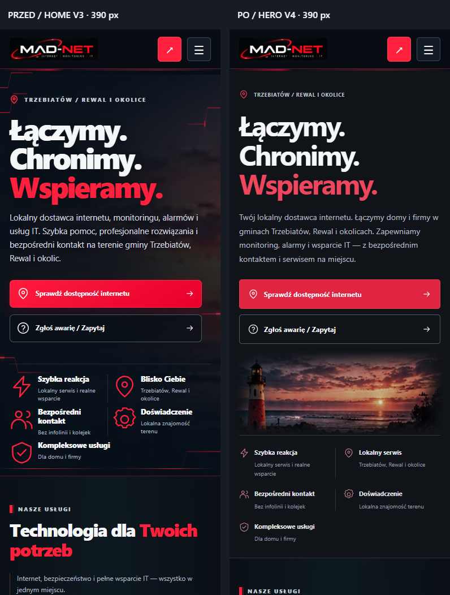
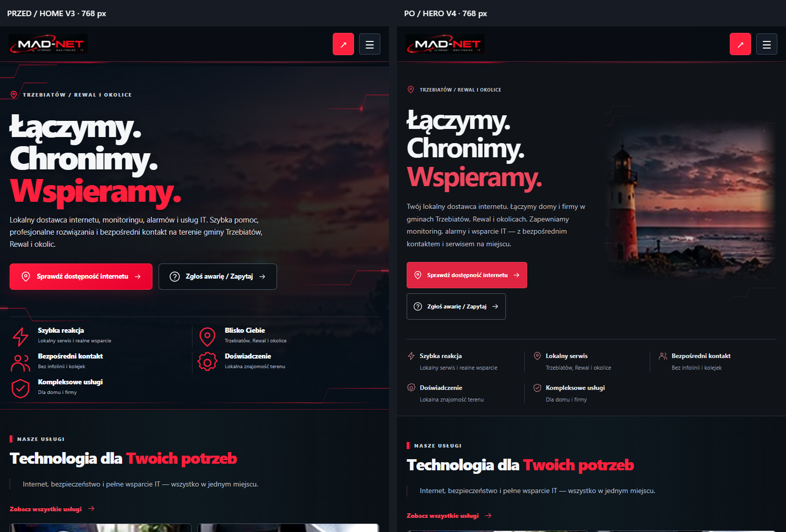
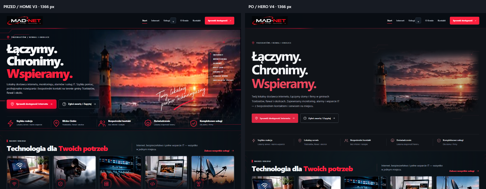
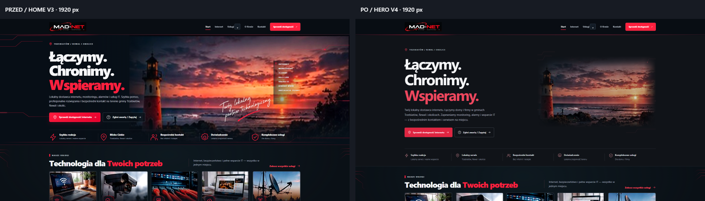

# MAD-NET — HERO V4

Zakres: wyłącznie HERO HOME i jego pasek zalet. Baza: `1987ad3` (`main` po PR #2). Nie zmieniono cennika, nagłówka, nawigacji, mapy ani kolejnych sekcji. Zmiany nie są wdrożeniem strony.

## 1. Audyt HOME V3

Aktualny kod i zrzuty przejrzano przed przebudową. Pełne kadry przeglądarki mają wysokość 1000 px; szerokości: [360](przed/360.png), [390](przed/390.png), [768](przed/768.png), [1366](przed/1366.png), [1440](przed/1440.png), [1920](przed/1920.png).

- `home.css` zawierał kilka generacji reguł HERO, w tym końcowe `background-size:100% 100%,100% 100%`. To zmieniało proporcje zdjęcia zamiast kontrolować jego kadr.
- Na desktopie lista siedmiu usług, odręczny podpis, duże czerwone ikony i nasycone zdjęcie konkurowały z hasłem oraz CTA.
- Na telefonie fotografia ginęła za treścią i przyciemnieniami; ścieżki zbliżały się do tekstu i przycisków. Przy 768 px widoczność zdjęcia nadal była niewielka.
- `nawigacja.css` odpowiada za wspólny nagłówek i zawiera też zatwierdzone korekty cennika. Pozostawiono go bez zmian. `home.js` obsługuje PCB kolejnych sekcji i mapę; nie wymagał zmiany.

## 2. Kompozycja V4

Tekst i fotografia mają osobne kolumny. Hasło zachowuje trzy wiersze, ma spokojniejszą grubość, czytelną interlinię i mniej nasycony akcent na ostatnim słowie. Komunikat zaczyna się od lokalnego dostawcy internetu. Zachowano oba CTA i ich dotychczasowe cele; przyciski mają minimum 52 px wysokości.

Na telefonach tekst i CTA poprzedzają niski kadr zdjęcia. Na tablecie fotografia wspiera tekst w drugiej kolumnie. Kontener ogranicza rozmiar kompozycji na 1920 i 2560 px.

Wszystkie pięć zalet pozostaje w pasku: szybka reakcja, lokalny serwis (wcześniej „Blisko Ciebie”), bezpośredni kontakt, doświadczenie i kompleksowość. Ikony są mniejsze i stonowane; separators oraz typografia mają jeden zestaw reguł responsywnych.

Usunięto listę usług i podpis z HTML HERO. Ich grafiki oraz archiwum V3 pozostają w repozytorium. Podpis można ponownie wykorzystać przy opisie firmy bez odtwarzania pliku.

Istniejący SVG ścieżek przeniesiono do kolumny fotografii. Nie nachodzi na tekst ani CTA. Impuls trwa 24 sekundy; brak neonowych filtrów. `prefers-reduced-motion` zatrzymuje animację. Dekoracje są pomijane przez czytniki ekranu i nie przechwytują wskaźnika.

## 3. Fotografia i ograniczenia materiału

Przeglądarka potwierdziła naturalne **1145 × 546 px**, JPEG **102 349 B**, dla `assets/img/home/latarnia-hero.jpg`. Obraz ma widoczną miękkość i artefakty kompresji. Zachowano autorski materiał, ograniczono jego rozmiar i nasycenie; nie dodano przypadkowego zdjęcia ani sztucznego powiększania rozdzielczości.

Fotografia jest elementem `` z wymiarami źródłowymi i `object-fit:cover`. Kadrowanie zachowuje proporcje, a maska delikatnie łączy krawędzie z tłem. Na tablecie kadr skupia się na latarni, na desktopie obejmuje też zachód słońca. Lokalizacja przedstawionego obiektu **nie jest potwierdzona** i nie jest przypisywana miejscowości w treści ani opisie obrazu.

Alternatywa przy późniejszej wymianie materiału: zachować obecny układ i wykorzystać autorskie zdjęcie infrastruktury lub regionu o większej rozdzielczości po potwierdzeniu jego pochodzenia. Do tego czasu obecna ograniczona kompozycja nie wymaga nowego zasobu.

## 4. Kontrolowana regresja

- Nowy `assets/css/hero.css` zawiera komplet stylów HERO i breakpointów 1120 / 780 / 600 px. Z `home.css` usunięto historyczne reguły HERO, podpisu i paska zalet oraz nieużywaną animację. Bez dodawania kolejnych nadpisań na końcu arkusza.
- Test sprawdza, że pozostałe reguły CSS zachowały treść i kolejność względem `1987ad3`. Osobny test porównuje cały HTML HOME po wyłączeniu zakresu HERO i jego odnośnika CSS.
- HERO V4 nie jest porównywany pikselowo z historycznym wyglądem. Sprawdzane są kolizje tekstu, fotografii i przycisków, granice ekranu, komplet pięciu zalet, proporcjonalne dopasowanie zdjęcia, kolejność klawiatury i ograniczony ruch.
- Siedem obszarów poza HERO nadal ma ścisłe porównanie pikseli. W sekcji regionu maskowany jest wyłącznie dynamiczny obszar mapy: kafelki online i warstwy z `backdrop-filter` renderowały się odmiennie po przewijaniu mimo identycznych stylów. Mapę chronią zamiast tego porównania geometrii (tolerancja 0,01 px), czcionek, kolorów, tła, transformacji i rozmycia oraz wszystkie istniejące testy wyboru miejscowości, współrzędnych, źródeł kafelków i zoomu. Nie usunięto testów interakcji ani kontroli cennika.
- Zakres przeglądarkowy: 320 / 360 / 375 / 390 / 430 / 768 / 1024 / 1366 / 1440 / 1920 / 2560 px. Oddzielny test nawigacji obejmuje menu, klawiaturę, dotyk, linki i dawne adresy.

Zrzuty sprawdzono wizualnie, oceniając typografię, kadr, separację treści, odstępy, CTA i położenie paska zalet. Nie jest to deklaracja pełnej zgodności WCAG ani test na fizycznych telefonach.

## Porównania PRZED / PO

### 390 px

### 768 px

### 1366 px

### 1920 px

Oryginalne PNG „po”: [360](po/360.png), [390](po/390.png), [768](po/768.png), [1366](po/1366.png), [1440](po/1440.png), [1920](po/1920.png). Porównania desktopowe skalują oba kadry jednakowo, bez zmiany proporcji.

## Środowisko pracy

W trakcie zadania w pierwotnym katalogu pojawiły się równoległe zmiany FIBER. Weryfikację V4 przeniesiono do `C:\GitHub\Projects\MAD-NET-hero-v4`, lokalna gałąź `codex/home-hero-premium-v4-isolated`. Gałęzią docelową do push i PR pozostaje zamówiona `feat/home-hero-premium-v4`. Równoległe zmiany nie należą do tej propozycji.

Wyniki końcowych poleceń i logi opisuje [weryfikacja](WERYFIKACJA.md).
