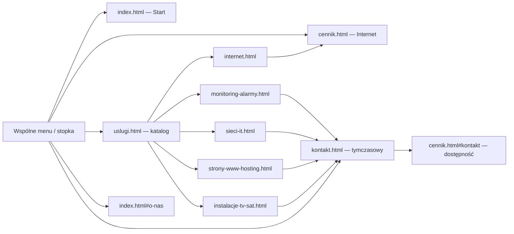

# MAD-NET — etap 03: nawigacja, katalog usług i zgodność URL

Data: 2026-11-01, Europe/Warsaw. Repo: `C:\GitHub\Projects\MAD-NET`. Gałąź: `feat/madnet-integracja-home-v3`. Ostatni ukończony etap 02: `603ecb6b34509db80b46d659b0eeb1368eb2f275`. Wznowienie z zapisu `32002bed6d8af8fdd740f8fe6c2af2d1e19db830` (`zapis po limicie`), obecnego lokalnie i na origin.

Na początku wznowienia status był czysty, bez zmodyfikowanych ani nieśledzonych plików. Zapis 32002be zawierał częściowy etap 03 i trzy wcześniej lokalne pliki HTML (V3, ankieta, plan). Ich nie usuwano ani nie dodawano ponownie w commicie dokończenia. Nie wykonano reset/clean/stash/rebase/force-push. Prace kontynuowano bez odtwarzania implementacji od początku.

## Audyt przy wznowieniu

| Stan | Ustalenie |
|---|---|
| GOTOWE | Statyczny wspólny nagłówek i stopka na dziewięciu stronach; istniejące logo; pięć bannerów katalogu; pięć stron usług i Kontakt jako jawne strony tymczasowe; względne CTA; ograniczony kod dawnych hashy; allowlista builda |
| CZĘŚCIOWO GOTOWE | Obsługa menu, dropdownu, fokusu i przekierowań istniała w kodzie, lecz nie była zweryfikowana przeglądarkowo |
| BRAKUJĄCE | Przeglądarkowe testy nawigacji/linków/dotyku/hashów, aktualizacja testu HOME, kontrola wizualna, raport, końcowy commit |
| WYMAGA POPRAWKI | Escape po hover mógł ponownie otwierać listę przez fokus; focusout zamykał ją przy Tab wewnątrz grupy; usunięta klasa brand przerywała start cennika; stare testy oczekiwały już usuniętych modali i całej strony sprzed zmiany nagłówka/stopki |

Wymienione elementy uzupełniono lub poprawiono miejscowo. Nie przeprowadzono etapu 04.

## Wynik i decyzje

- Wspólne menu: **Start, Internet, Usługi, O firmie, Kontakt**. Bez dodatkowych pustych pozycji Monitoring/Dla firm — ich cele są w dropdownie i katalogu.
- Kliknięcie nazwy „Usługi” prowadzi do katalogu. Osobny przycisk rozwija pięć celów. Mysz: hover; klawiatura: fokus w grupie, Tab/Enter/Space/Escape; dotyk: klik/tap, bez otwierania podczas scrollowania. Stan `aria-expanded` odpowiada widoczności listy. Brak pułapki fokusu.
- Logo to istniejące `assets/img/mad-net-logo.png`, bez modyfikacji bitmapy; jednolite w nagłówku i stopce. CSS wspólnych elementów jest ograniczone do ich klas i tokenów `--madnet-*`, bez globalnego resetu cennika.
- Katalog zawiera pięć dużych bannerów będących linkami: naprzemienne zdjęcia i tekst na desktopie, jedna kolumna na telefonie. Zdjęcia pochodzą z V3, bez rekompresji. Ikony i PCB pozostają dekoracjami poniżej treści, z pointer-events:none i obsługą reduced-motion.
- Pięć kart HOME ma te same zdjęcia, teksty i układ; obraz i CTA prowadzą do podstrony zamiast otwierać modal. Zgłoszenie/pytanie z HERO prowadzi do Kontakt. „Zobacz wszystkie usługi” prowadzi do katalogu.
- **Internet w menu → cennik.html** skraca drogę do porównania pakietów. **Internet w karcie/bannerze → internet.html** jest wejściem przez usługę. Ta tymczasowa strona ma widoczny przycisk „Porównaj pakiety internetu”; użytkownik nie kończy na pustym ekranie.
- Sześć stron tymczasowych ma widoczną etykietę „Strona tymczasowa” i dalszą drogę do katalogu, cennika lub kontaktu. Nie udają ukończonych opisów, formularza ani skutecznej wysyłki. Nie podano w nich nowych cen, referencji ani danych firmy.

## Mapa nawigacji

Wszystkie dziewięć stron zawiera wspólne menu i stopkę; pięć pozycji usług jest także w dropdownie. Stany aktywne: Start, Internet, Usługi/kategoria usługi, Kontakt. Na podstronie usługi jej własny link ma aria-current=page, kategoria w menu aria-current=true.

### Tabela celów

| Element | Cel względny | Stan |
|---|---|---|
| Logo / Start | `./index.html` | HOME |
| Internet w menu i stopce | `./cennik.html` | działający cennik |
| Nazwa Usługi / wszystkie usługi | `./uslugi.html` | katalog pięciu bannerów |
| O firmie | `./index.html#o-nas` | istniejąca sekcja HOME |
| Kontakt / Zgłoś awarię lub zapytaj | `./kontakt.html` | jawna strona tymczasowa |
| Główne CTA dostępności | `./cennik.html#kontakt` | istniejący formularz dostępności |
| Karta/banner/dropdown Internet | `./internet.html` | tymczasowa, z drogą do cennika |
| Monitoring i alarmy | `./monitoring-alarmy.html` | tymczasowa |
| Sieci LAN i usługi IT | `./sieci-it.html` | tymczasowa |
| Strony WWW i hosting | `./strony-www-hosting.html` | tymczasowa |
| Instalacje antenowe TV/SAT | `./instalacje-tv-sat.html` | tymczasowa |
| Porównaj pakiety / cennik w katalogu | `./cennik.html#cennik` | istniejąca sekcja pakietów |
| Napisz e-mail na stronie kontaktu | `mailto:biuro@mad-net.pl` | otwarcie klienta poczty, bez automatycznej wysyłki |

Maszynowa tabela wszystkich sprawdzonych odnośników: [nawigacja.json](03-dowody/nawigacja.json). W teście: **212 lokalnych odnośników**, **9 różnych stron HTTP 200**, istniejące docelowe fragmenty. Brak href="#" i starego hosta GitHub w wewnętrznych linkach produkcyjnych stron. Linki zewnętrzne OSM/Google, tel i mailto zachowują swój cel; nie wysyłano wiadomości ani nie wykonywano telefonów.

## Wsteczna zgodność URL

`stare-adresy.js` ładuje się tylko w index, przed głównymi stylami. Rozpoznaje dokładnie trzy stare fragmenty i używa location.replace, bez przepisywania dowolnych hashy ani zmian ustawień hostingu:

| Dawny URL | Nowy cel |
|---|---|
| `/MAD-NET/#cennik` | `/MAD-NET/cennik.html#cennik` |
| `/MAD-NET/#oplaty` | `/MAD-NET/cennik.html#oplaty` |
| `/MAD-NET/#kontakt` | `/MAD-NET/cennik.html#kontakt` |

Analogicznie działają root `/` i jawny `index.html`. Nowe linki Kontakt zawsze wskazują `kontakt.html`; stary #kontakt celowo nadal oznacza formularz dostępności. Test obejmuje 12 kombinacji bazowego URL i fragmentu, zmianę hash już otwartego HOME, a także #o-nas i nieznany fragment, które pozostają na HOME. Prefiks `/MAD-NET/` jest testowany przez lokalne odpowiedzi HTTP, bez wdrożenia Pages.

## Poprawki wykonane podczas dokończenia

1. **Escape:** najpierw ustawienie fokusu, potem zamknięcie listy. Zdarzenie focusin nie otwiera jej z powrotem.
2. **Tab w dropdownie:** sprawdzenie focusout odroczono do następnego zadania zdarzeń. Mikro-zadanie wykonywało się za wcześnie, gdy activeElement przejściowo wskazywał body.
3. **Cennik:** przywrócono klasy `brand` na logo i `nav` na nagłówku, zachowując wymagane selektory istniejących modułów. Bez tego `cennik.js` zgłaszał `Cannot read properties of null (reading 'src')`. Zachowano dotychczasową wysokość nagłówka cennika oraz jednolity wygląd bitmapy w wspólnych elementach. Nie zmieniano cennik.js, dostepnosc.js ani hero-rack.js.
4. **Testy HOME:** modalowe działania zastąpiono kontrolą rzeczywistych linków usług, aktualizowano listę ładowanych skryptów. Porównanie uwzględnia zamierzoną zmianę nagłówka i stopki; nadal kontroluje geometrię, fonty, kolory, źródłowe obrazy, mapę i PCB.
5. **Test V21:** pierwsza pełna próba zatrzymała się na przeciąganiu pinezki. Kod formularza wywołuje animowane panTo po kliknięciu mapy, więc test mógł pobierać pozycję jeszcze poruszającego się celu. Dodano oczekiwanie na stabilność przez hover, klatkę po przesunięciu i oczekiwanie na aktualizację opisu. Asercja zmiany pozycji i payload formularza pozostaje bez zmian; nie wyłączono przeciągania ani animacji produktu.
6. **Niski ekran cennika:** limit wysokości menu uwzględnia jego zachowany nagłówek 73 px. Test dotykowy sprawdza teraz wszystkie trzy główne strony w 390×480, zamiast samego katalogu.

## Testy

Środowisko: Windows, Node 24, Edge/Chromium headless. Przed uruchomieniem sprawdzano porty. Podgląd własny: 4173 (tym razem wolny), testy 4181/4182/4184/4185. Port 4193 należał do istniejącego procesu; PCB wykonano na sprawdzonym wolnym **4194**. Nie zatrzymywano innych projektów.

| Kontrola | Wynik |
|---|---|
| `npm run verify` | PASS — 13 testów i build dziewięciu stron |
| `node tests/home.browser.mjs` i HOME wewnątrz pełnego zestawu | PASS — 5 szerokości, geometria/typografia, linki usług, mapa/satelita/zoom/PCB, 6 tras smoke i HTTP zasobów |
| `npm run test:nawigacja` | PASS, exit 0 — 212 odnośników; 12 wariantów menu (3 strony × 4 szerokości); mouse hover, fokus, Tab/Enter/Space/Escape, brak pułapki fokusu; mapa nie przykrywa listy |
| Stare URL | PASS — 12 przekierowań, hashchange, dwa inne hashe bez przekierowania |
| Dotyk | PASS — tap otwiera, scroll nie otwiera; menu HOME/cennika/katalogu mieści się w 390×480 i pozwala przejść do ostatniej usługi |
| PCB | PASS — `MADNET_PORT_PCB=4194 npm run test:pcb`, 9 szerokości 360–2560, geometria/ruch/przełącznik/reduced motion |
| V21 po synchronizacji gestu | PASS — 64 kombinacje tabel, geokodowanie, mapa/przeciąganie, dane zapytania, awaria mapy i reduced motion |
| Końcowe `npm run test:browser` | PASS, exit 0 — V20: 169 tras; V21: tabele/mapa/formularz; HOME i pełna nawigacja bez błędów JS/konsoli |
| Prawdziwa wysyłka | SKIP — brak backendu api/zapytanie.php; testy przechwytują payload, nie potwierdzają doręczenia |

Próba poprzedzająca poprawkę synchronizacji V21 zakończyła się FAIL, a nie PASS. Wynik i przyczyna są jawnie zapisane w zbiorczym [logu](03-dowody/testy.txt). Aktualne testy używają rzeczywistego Leaflet; odpowiedź wyszukiwania adresu i backendu zapytania jest deterministycznie przechwycona, tak jak wcześniej. HOME korzysta z rzeczywistych kafelków Esri/CARTO online. Nie badano fizycznych telefonów, Safari ani Firefox.

## Kontrola wizualna i snapshoty

| Szerokość | HOME | Cennik | Katalog |
|---|---|---|---|
| 390 | [snapshot](03-dowody/index-390.png) | [snapshot](03-dowody/cennik-390.png) | [snapshot](03-dowody/uslugi-390.png) |
| 768 | [snapshot](03-dowody/index-768.png) | [snapshot](03-dowody/cennik-768.png) | [snapshot](03-dowody/uslugi-768.png) |
| 1440 | [snapshot](03-dowody/index-1440.png) | [snapshot](03-dowody/cennik-1440.png) | [snapshot](03-dowody/uslugi-1440.png) |
| 1920 | [snapshot](03-dowody/index-1920.png) | [snapshot](03-dowody/cennik-1920.png) | [snapshot](03-dowody/uslugi-1920.png) |

[Menu desktop](03-dowody/menu-desktop-1440.png), [menu w niskim ekranie dotykowym](03-dowody/menu-dotyk-390.png), [manifest SHA-256 screenshotów](03-dowody/manifest.json). Testy potwierdzają brak poziomego przepełnienia na tych szerokościach i brak przechwytywania kliknięć przez PCB. Zdjęcia źródłowe i oba stare arkusze cennika pozostały nietknięte.

**Nie deklarujemy pełnego pixel-perfect całej strony.** Nagłówek, logo w wspólnych elementach, menu i stopka zmieniły się celowo. Dla HERO HOME i kart osobno zmierzono geometrię, font i kolor; zgadzają się z V3. Rasteryzacja screenshotów daje jednak poniższe różnice. W cenniku main jest identyczny tekstowo z etapem 02, a jego kontrolowane wymiary, fonty i kolory są zgodne; różnica przy 768 px jest ograniczona do obszaru logo urządzenia (x 132–241, y 1536–1562 w kadrze main).

| Szerokość | Różne piksele HERO HOME | Karty HOME | Main cennika |
|---|---:|---:|---:|
| 390 | 0 | 0 | 0 |
| 768 | 0 | 0 | 1873 |
| 1024 | 31735 | 27387 | 0 |
| 1440 | 21071 | 15991 | 0 |
| 1920 | 56762 | 18402 | 0 |

To kontrolowany pomiar Edge/DPR 1, reduced motion; w cenniku zatrzymano animacje na czas zdjęcia. Przed porównaniem main wyłączono widoczność nagłówka i stopki, aby ich zmienione fragmenty nie wchodziły do kadru. Wymagania geometrii nie zostały zastąpione luźniejszą tolerancją porównania pikseli — różnice są raportowane, a układ i typografia mają osobne asercje do 0,01 px; integralność main i modułów chronią również testy statyczne. Wyniki maszynowe: [home.json](03-dowody/home.json). Źródłowe obrazy nie były obrabiane.

## Pliki i ograniczenia

Już w zapisie 32002be: index/cennik, uslugi i sześć stron tymczasowych; `assets/css/{nawigacja,uslugi}.css`, `assets/js/{nawigacja,stare-adresy,home}.js`; build, statyczne testy nawigacji i aktualizacja testów integralności. Zachowano tę implementację.

Dokończenie zmienia: `assets/css/nawigacja.css`, `assets/js/nawigacja.js`, `cennik.html`, `tests/home.browser.mjs`, `tests/v21.browser.mjs`, `package.json`, `.github/workflows/ci.yml`, README/ARCHITEKTURA; dodaje `tests/nawigacja.browser.mjs` oraz ten raport i dowody. CI nadal działa na feat/**; dodano wyniki etapu 03 do artefaktów, bez nowego deploy.

Pełna lista plików commita dokończenia: [pliki.txt](03-dowody/pliki.txt).

**Bez zmian względem etapu 02:** `assets/css/home.css`, `assets/css/styles.css`, `assets/css/hero-hybryda.css`, `assets/js/cennik.js`, `assets/js/dostepnosc.js`, `assets/js/hero-rack.js`, wszystkie obrazy, ceny i 13 pakietów LAN 5/FIBER 3/AIR 5. Archiwum V3 ma nadal SHA-256 `ceeef68c1d719bb37c161aa8df4c3c0a3395c7123da5e3f70571a6806dded99d`.

Pozostają jawne ograniczenia: pięć stron usług i Kontakt to strony tymczasowe; treści/dane firmy wymagają odrębnej weryfikacji biznesowej; brak backendu zapytań; mapy zależą od internetu. Pages nadal automatycznie publikuje z main, dlatego nie wykonywano merge, push main ani publikacji. Historyczne CI Linux/Chromium miało czerwone wyniki już w etapach 00–02; nowy stan CI raportowany jest osobno od lokalnych testów.

Rollback dokończenia: revert nowego commita na gałęzi integracyjnej przywróci zapis 32002be; nie jest to pełny rollback etapu 03. Wycofanie całego etapu wymagałoby osobnego polecenia i zwykłych revertów jego commitów, bez resetu/force-push. SHA końcowego commita można odczytać przez `git log -1 --format="%H %s" -- docs/integracja-home-v3/03-raport-nawigacji.md`; jest również w końcowej odpowiedzi.

**Zatrzymanie po etapie 03, przed etapem 04.**
